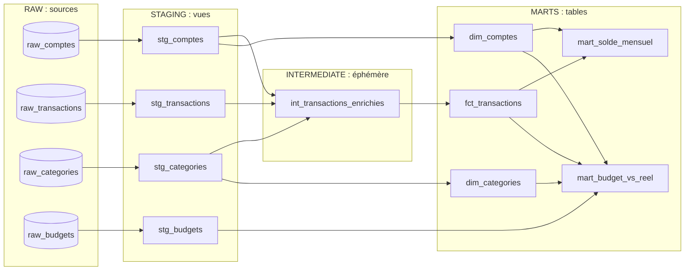
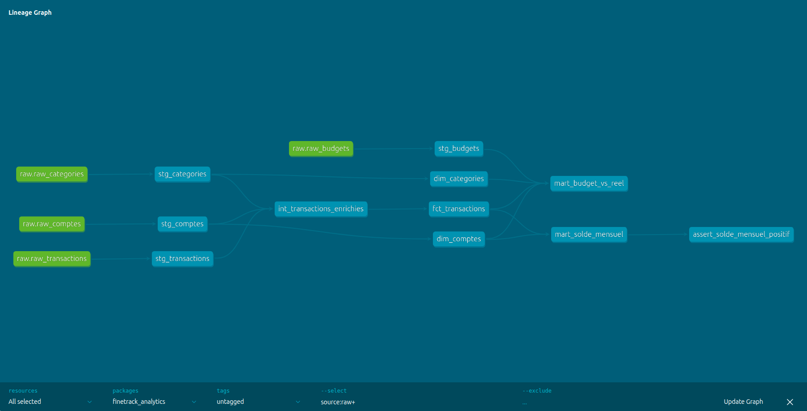
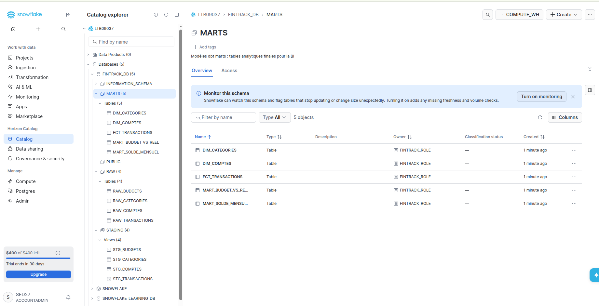
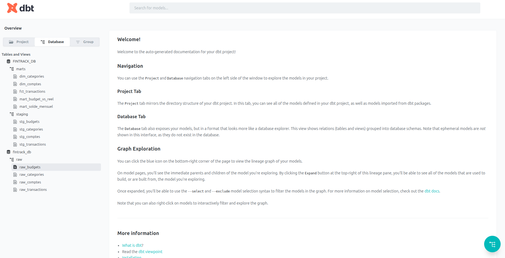
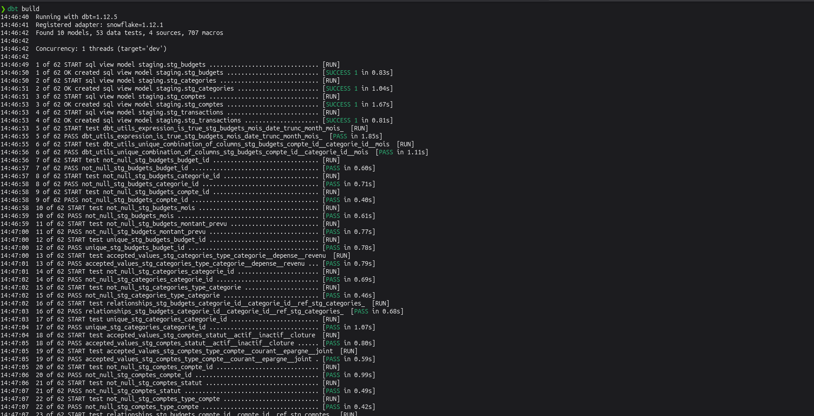
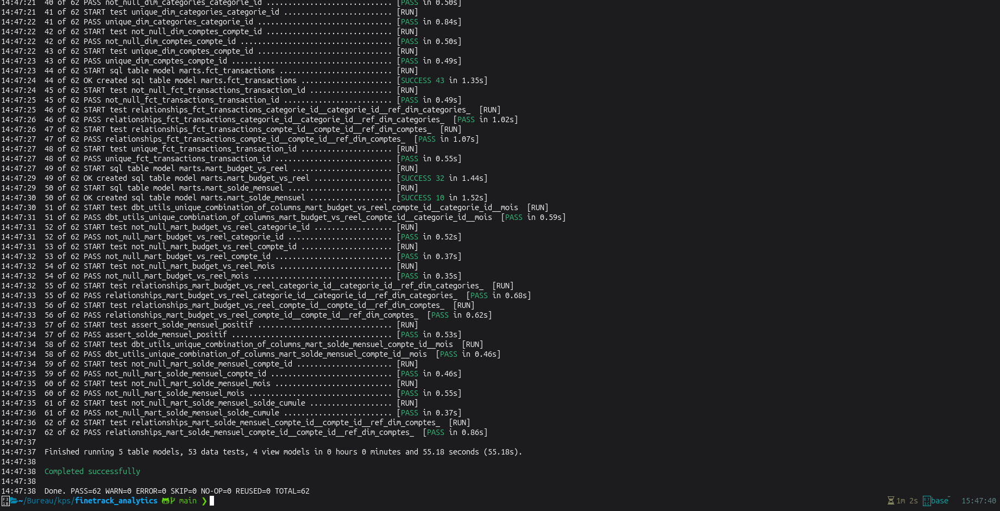

# FinTrack Analytics : entrepôt de données Snowflake + dbt

[](https://github.com/abrahamkoloboe27/FinetrackProject-Snowflake/actions/workflows/ci.yml)
[](https://github.com/abrahamkoloboe27/FinetrackProject-Snowflake/actions/workflows/cd.yml)
[](https://github.com/abrahamkoloboe27/FinetrackProject-Snowflake/actions/workflows/docs.yml)
[](https://github.com/abrahamkoloboe27/FinetrackProject-Snowflake/actions/workflows/scheduled-run.yml)

**Documentation de l'équipe : https://abrahamkoloboe27.github.io/FinetrackProject-Snowflake/** (démarrage, workflow Git, CI/CD, secrets, runbooks), et le **[catalogue dbt](https://abrahamkoloboe27.github.io/FinetrackProject-Snowflake/dbt/)** (modèles, colonnes, tests, lineage).

FinTrack Analytics est une fintech fictive qui propose une application de gestion de finances personnelles. Ce projet transforme ses données brutes (comptes, transactions, catégories, budgets) en modèles analytiques fiables, prêts à alimenter des tableaux de bord financiers.

- **Snowflake** héberge les données : base `FINTRACK_DB`, schémas `RAW`, `STAGING` et `MARTS`.
- **dbt** construit la chaîne de transformation, la teste et la documente.
- **GitHub Actions** teste chaque pull request, déploie chaque branche dans son environnement (`dev`, `staging`, `prod`) et publie la documentation.

Projet réalisé d'après le sujet « Snowflake + dbt : FinTrack Analytics » (niveau débutant), puis outillé pour un travail en équipe.

## Architecture




| Couche | Dossier | Matérialisation | Schéma Snowflake (prod) | Rôle |
|---|---|---|---|---|
| Sources | `RAW` | tables chargées par script | `RAW` | Données brutes, jamais modifiées par dbt |
| Staging | `models/staging/` | vue | `STAGING` | Renommer, typer, nettoyer les sources |
| Intermediate | `models/intermediate/` | éphémère | aucun | Jointures et enrichissements, injectés comme CTE |
| Marts | `models/marts/` | table | `MARTS` | Modèles finaux pour la BI |

Hors production, chaque environnement a ses propres schémas : `DEV_STAGING` et `DEV_MARTS` pour `dev`, `PREPROD_*` pour la recette, `CI_PR_<n>_*` pour la CI d'une pull request, `DEV_<PRENOM>_*` sur le poste d'un développeur. Voir [Environnements](https://abrahamkoloboe27.github.io/FinetrackProject-Snowflake/environnements/).

## Structure du dépôt

```
.
├── snowflake/                      Scripts Snowflake, à exécuter dans l'ordre
│   ├── 00_setup_environnement.sql    entrepôt, base, schémas, rôle, utilisateur
│   ├── 01_creer_tables.sql           les 4 tables sources du schéma RAW
│   ├── 02_inserer_donnees.sql        données d'exemple (12 / 6 / 45 / 25 lignes)
│   ├── 03_verifications.sql          contrôles après chargement
│   └── 04_ci_cd.sql                  droit CREATE SCHEMA, utilisateur de service de la CI
├── models/
│   ├── staging/                    stg_*.sql, _stg_sources.yml, _stg_models.yml
│   ├── intermediate/               int_transactions_enrichies.sql, _int_models.yml
│   └── marts/                      dim_*, fct_*, mart_*, _marts_models.yml
├── tests/                          test singulier : assert_solde_mensuel_positif.sql
├── macros/                         generate_schema_name.sql, drop_ci_schemas.sql
├── ci/profiles.yml                 profil dbt de GitHub Actions (sans secret : variables d'environnement)
├── .github/
│   ├── workflows/                  CI, PR policy, CD, Docs, CI cleanup, Scheduled prod run
│   ├── actions/setup-dbt/          action composite : Python, dbt, dbt deps
│   ├── rulesets/                   protections des branches main, staging, dev
│   ├── ISSUE_TEMPLATE/             formulaires d'issue
│   ├── pull_request_template.md
│   ├── CODEOWNERS
│   └── dependabot.yml
├── scripts/
│   ├── setup_github.sh             configure le dépôt GitHub (rulesets, environnements, Pages)
│   └── ci/                         scripts appelés par les workflows
├── docs/                           site de documentation (MkDocs Material)
├── assets/                         captures d'écran (README et site)
├── dbt_project.yml
├── packages.yml                    dbt_utils, codegen (versions figées dans package-lock.yml)
├── requirements.txt                dbt-core, dbt-snowflake
├── requirements-docs.txt           MkDocs Material
├── requirements-dev.txt            tout, plus pre-commit, sqlfluff, yamllint
├── Makefile                        raccourcis : make help
├── mkdocs.yml
├── .pre-commit-config.yaml         lint : sqlfluff, yamllint, shellcheck, actionlint...
├── .sqlfluff, .yamllint.yml        règles de style SQL et YAML
├── CONTRIBUTING.md
└── CHANGELOG.md
```

## Démarrage

Le guide complet, pour un nouveau membre de l'équipe, est sur le site : [Démarrage](https://abrahamkoloboe27.github.io/FinetrackProject-Snowflake/demarrage/).

### 1. Préparer Snowflake

Dans une feuille Snowsight, exécutez les scripts de `snowflake/` dans l'ordre (`00`, `01`, `02`, puis `03` pour contrôler, et `04` pour la CI/CD : sa section 1 seulement si la CI utilise un mot de passe). Un compte d'essai Snowflake suffit : son rôle `ACCOUNTADMIN` donne accès à `SYSADMIN`, `SECURITYADMIN` et `USERADMIN`, utilisés par les scripts.

> **Avant d'exécuter `00_setup_environnement.sql`**, remplacez `<MOT_DE_PASSE_A_DEFINIR>` par votre propre mot de passe pour `FINTRACK_USER`. Ne le versionnez jamais.

Le script 00 accorde à `FINTRACK_ROLE` la lecture seule sur `RAW` et tous les droits sur `STAGING` et `MARTS`. Le script 04 lui donne en plus le droit de créer des schémas : dbt crée ainsi les schémas de chaque environnement (`DEV_*`, `PREPROD_*`, `CI_PR_*`). Pour une CI par paire de clés, il crée aussi `FINTRACK_CI_USER`, l'utilisateur de service de GitHub Actions, authentifié par paire de clés RSA.



### 2. Installer l'outillage

Python 3.12 est requis (`.python-version`).

```bash
make install                   # crée .venv, installe requirements-dev.txt et les hooks pre-commit
source .venv/bin/activate
```

`requirements.txt` fixe les versions utilisées partout, CI comprise : dbt-core 1.12.6 et dbt-snowflake 1.12.3. La syntaxe `arguments:` des tests génériques exige dbt 1.10.5 ou plus récent.

### 3. Configurer dbt

Créez `~/.dbt/profiles.yml`. Le nom du profil doit être celui de `dbt_project.yml`. Choisissez un schéma personnel `DEV_<PRENOM>` : vos modèles iront dans `DEV_<PRENOM>_STAGING` et `DEV_<PRENOM>_MARTS`, sans toucher à ceux des autres ni à la production.

```yaml
finetrack_analytics:
  target: dev
  outputs:
    dev:
      type: snowflake
      account: <votre_compte>         # ex : ORGNAME-ACCOUNTNAME
      user: FINTRACK_USER
      password: '<votre_mot_de_passe>'
      role: FINTRACK_ROLE
      database: FINTRACK_DB
      warehouse: FINTRACK_WH
      schema: DEV_<PRENOM>            # ex : DEV_ABRAHAM
      threads: 4
```

La connexion par mot de passe est valable sur un compte d'essai. Sur un compte payant ou d'entreprise, Snowflake impose une authentification renforcée : utilisez alors une paire de clés RSA.

Ne nommez jamais votre target locale `prod` : seule cette target écrit dans les schémas de production `STAGING` et `MARTS`.

> **Profil créé avant la version 1.1.0 ?** L'ancienne consigne utilisait `schema: STAGING`. Remplacez-le par `DEV_<PRENOM>` : sinon dbt s'arrête avec le message « Le schéma STAGING de la target dev est réservé à la production ».

### 4. Construire, tester, documenter

```bash
make deps              # dbt deps : installe dbt_utils et codegen
make debug             # dbt debug : vérifie la connexion
make build             # dbt build : construit les modèles et exécute les tests, dans l'ordre du DAG
make dbt-docs          # dbt docs generate + serve : documentation et lineage dans le navigateur
make help              # toutes les commandes (lint, parse, docs...)
```

Lancez toujours dbt avec `FINTRACK_ROLE`, pas avec `ACCOUNTADMIN` : les objets créés appartiendraient à `ACCOUNTADMIN` et `FINTRACK_ROLE` ne pourrait plus les remplacer.



## Les modèles

| Modèle | Contenu |
|---|---|
| `stg_comptes` | Comptes : `id` devient `compte_id`, statut en minuscules |
| `stg_transactions` | Transactions typées, avec `montant_signe` (+ pour un crédit, - pour un débit) |
| `stg_categories` | Catégories renommées : `categorie_id`, `nom_categorie`, `type_categorie` |
| `stg_budgets` | Budgets mensuels, mois typé en `DATE` |
| `int_transactions_enrichies` | Transactions + client, type de compte, catégorie, groupe et `mois_transaction` |
| `dim_comptes` | Dimension des comptes, avec `anciennete_jours` |
| `dim_categories` | Dimension des catégories |
| `fct_transactions` | Faits : transactions **validées** uniquement |
| `mart_solde_mensuel` | Crédits, débits, solde net et solde cumulé par compte et par mois |
| `mart_budget_vs_reel` | Dépenses réelles contre budget par compte, catégorie et mois (`FULL OUTER JOIN`) |

Chaque modèle et chaque colonne est décrit dans les fichiers YAML de sa couche (`_stg_models.yml`, `_int_models.yml`, `_marts_models.yml`) et les sources dans `_stg_sources.yml`.

## Qualité des données

53 tests, tous exécutés par `dbt build` :

| Type | Nombre | Exemples |
|---|---|---|
| `not_null` | 26 | clés, statuts, montants, types d'opération |
| `unique` | 7 | `compte_id`, `transaction_id`, `categorie_id`, `budget_id` |
| `relationships` | 9 | transactions vers comptes et catégories, faits vers dimensions |
| `accepted_values` | 5 | `type_compte`, `statut`, `type_operation`, `type_categorie` |
| `unique_combination_of_columns` | 3 | grain de `stg_budgets` et des deux marts |
| `accepted_range` | 1 | `montant` strictement positif |
| `expression_is_true` | 1 | `mois` des budgets = premier jour du mois |
| singulier | 1 | `assert_solde_mensuel_positif` : aucun compte épargne à solde cumulé négatif |

`accepted_values` et `relationships` ignorent les valeurs `NULL` : c'est pourquoi les colonnes concernées ont aussi un test `not_null`. Sans lui, une transaction sans statut disparaîtrait des marts sans qu'aucun test n'échoue.

Ces tests tournent sur chaque pull request (dans des schémas `CI_PR_<n>_*` jetables), à chaque déploiement, et chaque matin sur la production.

## Choix de conception

- **Staging sans filtre.** Les vues restent en correspondance une pour une avec les sources : les anomalies sont signalées par les tests au lieu d'être masquées. Seul `fct_transactions` filtre (`statut = 'validee'`).
- **`montant_signe` vaut `NULL` pour un type d'opération inconnu**, et non 0 : le test `not_null` le signale.
- **Jointures `LEFT JOIN`** dans `int_transactions_enrichies` : une transaction dont le compte ou la catégorie serait introuvable reste visible, et les tests `relationships` la signalent.
- **`mart_solde_mensuel`** a une ligne par compte et par mois comptant au moins une transaction validée. Un mois sans transaction n'a pas de ligne, et un compte sans transaction validée (le compte clôturé de l'échantillon) n'apparaît pas. Le solde cumulé n'est le solde réel que si toutes les transactions depuis l'ouverture sont chargées, ce qui n'est pas le cas de l'échantillon (janvier à mars 2024).
- **`mart_budget_vs_reel`** : `ecart = montant_reel - montant_prevu` (positif = dépense supérieure au budget). `depassement` n'est vrai que si un budget existe : une dépense sans budget (`montant_prevu = 0`) n'est pas un dépassement de budget. Pour repérer les dépassements, filtrez sur `depassement`, pas sur le signe de `ecart`.
- **`type_categorie` et `type_operation` sont deux axes indépendants.** Les virements reçus sur le compte épargne sont des crédits rangés dans « Épargne versée », une catégorie de type `depense`.
- **`generate_schema_name`** : par défaut, dbt nomme les schémas `<schéma du profil>_<schéma personnalisé>`. La macro du projet garde ce préfixe hors production, pour isoler chaque environnement (`DEV_ABRAHAM_STAGING`, `PREPROD_MARTS`, `CI_PR_12_MARTS`), et utilise le schéma personnalisé tel quel pour la seule target `prod` : la production reste dans `STAGING` et `MARTS`. Les noms sont mis en majuscules.

## Résultats attendus sur l'échantillon

Après `dbt build`, ces valeurs doivent apparaître :

| Compte | Solde cumulé fin mars 2024 |
|---|---|
| 1 Alice Dupont | 7 350,83 |
| 2 Bob Martin | 5 476,92 |
| 3 Claire Leroy | 5 900,00 |
| 4 David Moreau | 7 748,70 |
| 5 Emma Bernard | 2 355,00 |
| 6 Frank Petit | aucune ligne (aucune transaction validée) |

`fct_transactions` compte 43 lignes sur 45 : une transaction en attente et une rejetée sont exclues. `mart_budget_vs_reel` compte 32 lignes dont 2 dépassements : Alice, Restaurant, février 2024 (60 prévus, 89 dépensés) et Bob, Vêtements, janvier 2024 (80 prévus, 120 dépensés).

## Validation

- `dbt build` sur Snowflake : 62 nœuds (9 modèles et 53 tests), 0 erreur. Le projet compte 10 modèles : le modèle éphémère n'est pas exécuté en tant que tel.
- Les tables `fct_transactions`, `mart_solde_mensuel`, `mart_budget_vs_reel` et `dim_comptes` ont été comparées, ligne par ligne, à un calcul indépendant en Python : résultats identiques.
- Les tests ont été éprouvés en corrompant volontairement les données (doublon, compte inconnu, statut `NULL`, montant négatif, budget en double, retrait massif sur le compte épargne...) : chaque corruption fait échouer le test attendu.

Après avoir modifié des données sources, relancez `dbt build` et non `dbt test` seul : les tests des marts portent sur les tables telles qu'elles ont été construites la dernière fois.

<details>
<summary>Captures d'un <code>dbt build</code> complet (PASS=62)</summary>





</details>

## Questions du sujet

**Quelle différence entre vue, table et éphémère ?** Une *vue* stocke la requête et la rejoue à chaque lecture : toujours à jour, mais recalculée. Une *table* stocke le résultat : rapide à lire, mise à jour à chaque `dbt run`. Un modèle *éphémère* ne crée aucun objet : dbt l'injecte comme CTE dans les modèles qui l'utilisent. D'où les choix : vues pour le staging (données changeantes, calcul léger), éphémère pour les jointures intermédiaires (jamais lues directement), tables pour les marts (lus souvent par la BI).

**Pourquoi séparer staging, intermediate et marts ?** Chaque couche a une seule responsabilité : le staging isole le contact avec les sources (si une colonne change à la source, un seul fichier est à corriger), l'intermediate factorise les jointures, les marts exposent des modèles finaux et stables à la BI. Cela rend les modèles lisibles, réutilisables et testables à la bonne étape.

**Quel avantage pour le test `relationships` ?** Snowflake n'applique pas les clés étrangères. Le test vérifie l'intégrité référentielle : une transaction qui pointe vers un compte ou une catégorie inexistants est détectée avant de fausser les agrégats des marts.

## Travailler en équipe / CI-CD

Le dépôt suit un GitFlow allégé à trois branches longues, chacune déployée dans son environnement :

| Branche | Environnement | Schémas |
|---|---|---|
| `dev` | intégration | `DEV_STAGING`, `DEV_MARTS` |
| `staging` | recette | `PREPROD_STAGING`, `PREPROD_MARTS` |
| `main` | production | `STAGING`, `MARTS` |

- Le travail se fait sur une branche `feature/...`, `fix/...`, `docs/...` créée depuis `dev`, puis une PR vers `dev` au titre [Conventional Commits](https://www.conventionalcommits.org/fr/v1.0.0/) (`feat(marts): ...`), fusionnée par squash.
- Chaque PR doit passer cinq checks : `Lint`, `dbt parse`, `Docs build`, `dbt build (CI)` (dans des schémas `CI_PR_<n>_*` jetables) et `PR policy`, puis être approuvée.
- Les releases passent par des PR `dev` → `staging` puis `staging` → `main` (merge commit). Une fusion dans `main` déploie la production, crée la release `v<version>` si cette version de `dbt_project.yml` n'est pas encore publiée, et met le site à jour.
- Un correctif urgent part de `main` (`hotfix/...`) et redescend ensuite vers `staging` et `dev` (back-merge).

Tout est détaillé sur le site : [Workflow Git](https://abrahamkoloboe27.github.io/FinetrackProject-Snowflake/workflow-git/), [CI/CD](https://abrahamkoloboe27.github.io/FinetrackProject-Snowflake/ci-cd/), [Runbooks](https://abrahamkoloboe27.github.io/FinetrackProject-Snowflake/runbooks/). Pour contribuer : [CONTRIBUTING.md](CONTRIBUTING.md).

## Sécurité

Aucun secret n'est versionné : `profiles.yml` (sauf `ci/profiles.yml`, qui ne contient que des appels à `env_var()`), les clés privées (`*.p8`, `*.pem`) et le fichier `.env` sont ignorés par Git, et des hooks pre-commit bloquent une clé commitée par erreur : `detect-private-key` (clé PEM avec en-tête) et `detect-private-key-base64` (clé RSA en base64 sur une ligne). `ci-profiles-env-var-only` refuse tout identifiant écrit en clair dans `ci/profiles.yml`. Aucun hook ne repère un mot de passe ailleurs : n'en collez jamais dans un fichier du dépôt. Le mot de passe de `FINTRACK_USER` se règle dans le script 00 avant exécution, puis se recopie dans `~/.dbt/profiles.yml`.

Les identifiants Snowflake de GitHub Actions sont des secrets GitHub (`SNOWFLAKE_ACCOUNT`, `SNOWFLAKE_USER`, `SNOWFLAKE_PASSWORD` ou `SNOWFLAKE_PRIVATE_KEY`...), au niveau du dépôt ou d'un environnement. Aujourd'hui, la CI se connecte avec `FINTRACK_USER` et son mot de passe (secrets du dépôt, compte d'essai) ; la paire de clés avec l'utilisateur de service `FINTRACK_CI_USER` est recommandée. Avant d'ajouter un collaborateur, la CI de PR, qui exécute le code des PR, doit recevoir un utilisateur en lecture seule sur la production. Les workflows ont des permissions minimales, ne transmettent aucun secret aux PR venant d'un fork, et masquent le compte et l'utilisateur dans les artefacts publiés. Liste et procédure : [Secrets](https://abrahamkoloboe27.github.io/FinetrackProject-Snowflake/secrets/).
