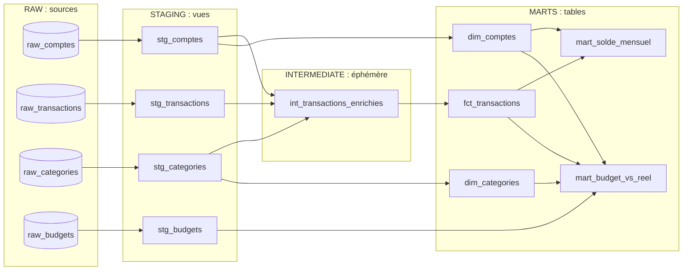
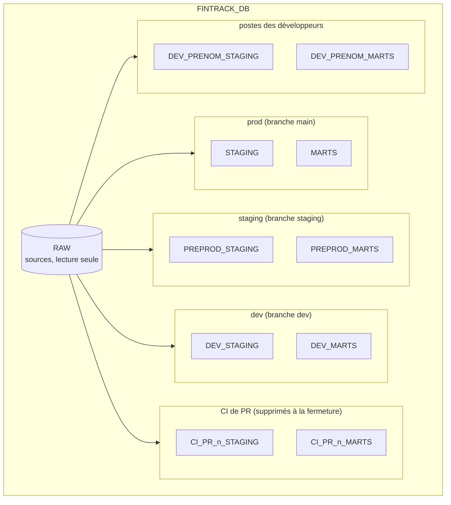

# Architecture

Le projet suit l'organisation en couches recommandée par dbt : chaque couche a une seule responsabilité et ne lit que la couche précédente.

## Les couches

Le même lineage, tel que le dessine `dbt docs` :

| Couche | Dossier | Matérialisation | Schéma Snowflake (prod) | Rôle |
|---|---|---|---|---|
| Sources | `RAW` | tables chargées par script | `RAW` | Données brutes, jamais modifiées par dbt |
| Staging | `models/staging/` | vue | `STAGING` | Renommer, typer, nettoyer les sources |
| Intermediate | `models/intermediate/` | éphémère | aucun | Jointures et enrichissements, injectés comme CTE |
| Marts | `models/marts/` | table | `MARTS` | Modèles finaux pour la BI |

Hors production, les schémas sont préfixés par l'environnement : `DEV_STAGING`, `PREPROD_MARTS`, `CI_PR_12_STAGING`... Voir [Environnements](environnements.md).

Les matérialisations sont fixées par couche dans `dbt_project.yml` (`+materialized`, `+schema`). Un modèle peut les surcharger avec `{{ config(...) }}`, mais ce n'est le cas d'aucun modèle aujourd'hui.

## Pourquoi ces matérialisations

- Une **vue** stocke la requête et la rejoue à chaque lecture : toujours à jour, mais recalculée. Idéal pour le staging : données changeantes, calcul léger.
- Une **table** stocke le résultat : rapide à lire, mise à jour à chaque `dbt build`. Idéal pour les marts, lus souvent par la BI.
- Un modèle **éphémère** ne crée aucun objet : dbt l'injecte comme CTE dans les modèles qui l'utilisent. Idéal pour les jointures intermédiaires, jamais lues directement.

Séparer staging, intermediate et marts donne à chaque couche une seule responsabilité. Le staging isole le contact avec les sources : si une colonne change à la source, un seul fichier est à corriger. L'intermediate factorise les jointures. Les marts exposent à la BI des modèles finaux et stables.

## Snowflake

Tout le projet vit dans un seul compte Snowflake.

| Objet | Nom | Rôle |
|---|---|---|
| Entrepôt | `FINTRACK_WH` | XS, s'éteint après 60 s d'inactivité, se rallume à la requête |
| Base | `FINTRACK_DB` | toutes les données du projet |
| Schéma | `RAW` | sources brutes, en lecture seule pour dbt, partagées par tous les environnements |
| Schémas | `STAGING`, `MARTS` | production |
| Schémas | `PREPROD_*`, `DEV_*`, `DEV_<PRENOM>_*`, `CI_PR_<n>_*` | recette, intégration, postes des développeurs, CI de PR (créés par dbt) |
| Rôle | `FINTRACK_ROLE` | lecture de `RAW` ; tous les droits sur `STAGING` et `MARTS` (script 00) ; `CREATE SCHEMA` sur `FINTRACK_DB` (script 04), d'où la propriété des schémas `DEV_*`, `PREPROD_*` et `CI_PR_*` que dbt crée |
| Utilisateur | `FINTRACK_USER` | utilisateur de type `PERSON`, pour dbt en local ; aujourd'hui aussi celui de GitHub Actions (mot de passe, compte d'essai) |
| Utilisateur | `FINTRACK_CI_USER` | utilisateur de type `SERVICE` (paire de clés RSA), pour GitHub Actions (optionnel : CI par paire de clés, recommandée) |

La répartition des rôles d'administration suit les bonnes pratiques Snowflake :

| Rôle système | Ce qu'il fait ici |
|---|---|
| `SYSADMIN` | crée et possède l'entrepôt, la base et les schémas initiaux |
| `USERADMIN` | crée le rôle et les utilisateurs |
| `SECURITYADMIN` | accorde les droits (seul avec `ACCOUNTADMIN` à détenir `MANAGE GRANTS`, indispensable pour les droits `FUTURE`) |

## Les scripts Snowflake

Les scripts de `snowflake/` s'exécutent dans l'ordre, dans une feuille Snowsight. Un compte d'essai suffit : son rôle `ACCOUNTADMIN` donne accès à `SYSADMIN`, `SECURITYADMIN` et `USERADMIN`.

| Script | Contenu | Quand l'exécuter |
|---|---|---|
| `00_setup_environnement.sql` | entrepôt, base, schémas `RAW` / `STAGING` / `MARTS`, rôle, utilisateur `FINTRACK_USER` | une fois, à l'installation |
| `01_creer_tables.sql` | les 4 tables sources du schéma `RAW` | une fois (le relancer vide les tables) |
| `02_inserer_donnees.sql` | données d'exemple (12 catégories, 6 comptes, 45 transactions, 25 budgets) | après `01` |
| `03_verifications.sql` | contrôles après chargement, chaque requête indique son résultat attendu | après `02` |
| `04_ci_cd.sql` | droit `CREATE SCHEMA` pour `FINTRACK_ROLE`, utilisateur de service `FINTRACK_CI_USER`, séparation optionnelle de la CI et de la production | section 1 obligatoire, une fois, avant la première CI ; sections 2 et 3 pour la paire de clés ; section 6 avant d'ajouter un collaborateur (voir [Secrets](secrets.md#script-04)) |

!!! warning "Avant d'exécuter `00_setup_environnement.sql`"

    Remplacez `<MOT_DE_PASSE_A_DEFINIR>` par votre propre mot de passe pour `FINTRACK_USER`. Ne le versionnez jamais : remettez le texte d'origine une fois l'utilisateur créé.

Dans Snowsight, « Run all » n'affiche que le résultat de la dernière requête. Pour voir un contrôle, exécutez-le seul : curseur dans la requête, puis Ctrl+Entrée.

## Choix de conception

- **Staging sans filtre.** Les vues restent en correspondance une pour une avec les sources : les anomalies sont signalées par les tests au lieu d'être masquées. Seul `fct_transactions` filtre (`statut = 'validee'`).
- **`montant_signe` vaut `NULL` pour un type d'opération inconnu**, et non 0 : le test `not_null` le signale.
- **Jointures `LEFT JOIN`** dans `int_transactions_enrichies` : une transaction dont le compte ou la catégorie serait introuvable reste visible, et les tests `relationships` la signalent.
- **`mart_solde_mensuel`** a une ligne par compte et par mois comptant au moins une transaction validée. Un mois sans transaction n'a pas de ligne, et un compte sans transaction validée (le compte clôturé de l'échantillon) n'apparaît pas. Le solde cumulé n'est le solde réel que si toutes les transactions depuis l'ouverture sont chargées, ce qui n'est pas le cas de l'échantillon (janvier à mars 2024).
- **`mart_budget_vs_reel`** : `ecart = montant_reel - montant_prevu` (positif = dépense supérieure au budget). `depassement` n'est vrai que si un budget existe : une dépense sans budget (`montant_prevu = 0`) n'est pas un dépassement de budget. Pour repérer les dépassements, filtrez sur `depassement`, pas sur le signe de `ecart`.
- **`type_categorie` et `type_operation` sont deux axes indépendants.** Les virements reçus sur le compte épargne sont des crédits rangés dans « Épargne versée », une catégorie de type `depense`.
- **`generate_schema_name`** : par défaut, dbt nommerait les schémas `<schéma du profil>_<schéma personnalisé>` dans tous les environnements. La macro du projet garde ce préfixe hors production, pour isoler chaque environnement (`DEV_ABRAHAM_STAGING`, `CI_PR_12_MARTS`), et utilise le schéma personnalisé tel quel en production (`STAGING`, `MARTS`). Détail dans [Environnements](environnements.md#la-macro-generate_schema_name).
- **Une seule base, plusieurs schémas.** Les environnements partagent `RAW` et l'entrepôt : pas de copie de données, un seul jeu de droits à maintenir. L'isolation se fait par schéma.
