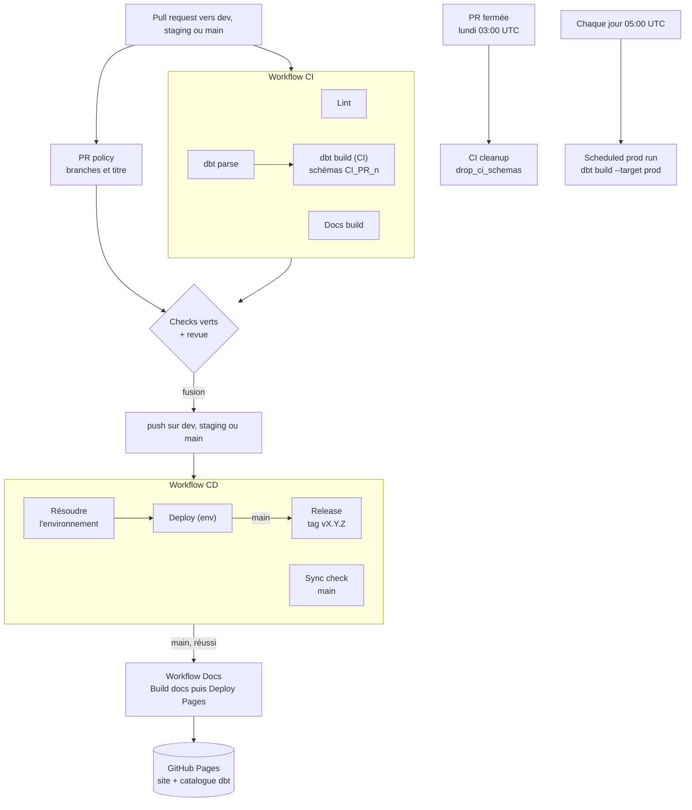

# CI/CD

Six workflows GitHub Actions automatisent le cycle de vie du projet : ils vérifient chaque pull request, déploient chaque branche longue dans son environnement, publient ce site et entretiennent Snowflake. Ils sont dans `.github/workflows/`.

## Vue d'ensemble



## Les workflows

| Workflow | Fichier | Déclencheurs | Jobs |
|---|---|---|---|
| CI | `ci.yml` | pull request vers `dev`, `staging` ou `main` (ouverte, nouveau push, réouverte, sortie de brouillon) | `Lint`, `dbt parse`, `Docs build`, `dbt build (CI)` |
| PR policy | `pr-policy.yml` | les mêmes, plus la modification du titre | `PR policy` |
| CD | `cd.yml` | push sur `dev`, `staging` ou `main` (sauf documentation seule) ; manuel | `Résoudre l'environnement`, `Deploy (<env>)`, `Release` et `Sync check` (main) |
| Docs | `docs.yml` | fin d'un CD réussi sur `main` ; push sur `main` qui touche la documentation ; manuel depuis `main` | `Build docs`, `Deploy Pages` |
| CI cleanup | `cleanup-ci.yml` | PR fermée ; chaque lundi à 03:00 UTC ; manuel (avec simulation possible) | `Nettoyer les schémas CI` |
| Scheduled prod run | `scheduled-run.yml` | chaque jour à 05:00 UTC ; manuel depuis `main` | `dbt build (prod)` |

Une action composite, `.github/actions/setup-dbt`, factorise l'installation de dbt (voir [plus bas](#laction-setup-dbt)).

## Les checks requis

Une PR ne peut être fusionnée que si ces cinq checks sont verts. Leur nom est celui du job (`name:`) : c'est lui que les rulesets exigent.

| Check | Workflow | Ce qu'il vérifie | Reproduire en local |
|---|---|---|---|
| `Lint` | CI | tous les hooks pre-commit sur tous les fichiers : espaces, YAML, SQL (sqlfluff), shell, workflows, clés privées | `make lint` |
| `dbt parse` | CI | le projet dbt est valide (Jinja, `ref`, YAML, syntaxe dépréciée), **sans connexion à Snowflake** | `make parse` |
| `Docs build` | CI | ce site se construit en mode strict (liens et ancres valides) | `make docs` |
| `dbt build (CI)` | CI | modèles et tests exécutés sur Snowflake, dans les schémas `CI_PR_<n>_*` | `make build` (dans vos schémas) |
| `PR policy` | PR policy | branche source autorisée pour cette base, titre Conventional Commits | `BASE_REF=dev HEAD_REF=feature/x PR_TITLE="feat: x" scripts/ci/check_pr_policy.sh` |

!!! warning "Renommer un job casse la protection"

    Si le `name:` d'un de ces jobs change, le ruleset attend un check qui n'arrive plus : toutes les PR restent bloquées sur « Expected — Waiting for status to be reported ». Mettez à jour `.github/rulesets/*.json` dans la même PR, puis relancez `scripts/setup_github.sh`.

Un job ignoré par sa condition `if:` compte comme réussi. C'est le cas de `dbt build (CI)` pour une PR en brouillon, venant d'un fork ou ouverte par Dependabot : voir [la sécurité des workflows](#securite-des-workflows).

## CI : vérifier chaque pull request

- **Concurrence** : un nouveau push sur la PR annule l'exécution précédente (`ci-<numéro de PR>`).
- **Permissions** : lecture seule du code (`contents: read`). Seul `dbt build (CI)` lit en plus les artefacts d'autres workflows (`actions: read`), pour la Slim CI.

### Lint

Installe pre-commit (version de `requirements-dev.txt`), puis `pre-commit run --all-files --show-diff-on-failure`. Chaque hook a son propre environnement, mis en cache dans `~/.cache/pre-commit` (clé : `.pre-commit-config.yaml`). En cas d'échec, le journal montre le diff que le hook aurait appliqué : lancez `make lint` en local, committez les corrections.

Les hooks : `trailing-whitespace`, `end-of-file-fixer`, `mixed-line-ending`, `check-yaml`, `check-json`, `check-merge-conflict`, `check-added-large-files` (500 Ko au plus), `detect-private-key` (clé PEM avec en-tête), `detect-private-key-base64` (clé RSA en base64 sur une ligne), `ci-profiles-env-var-only` (aucun identifiant en clair dans `ci/profiles.yml`), yamllint (`.yamllint.yml`), sqlfluff (`.sqlfluff`), shellcheck, actionlint, et les schémas officiels de l'action composite et de `dependabot.yml` (check-jsonschema).

### dbt parse

Installe dbt avec `setup-dbt`, puis lance `dbt parse --target ci --warn-error --no-partial-parse` et `dbt ls --target ci` avec des identifiants **factices** (`SNOWFLAKE_ACCOUNT=ci-offline`...). Aucun accès à Snowflake : ce check tourne même sans secret, et sur les PR venant d'un fork. Il détecte en quelques secondes un `ref()` vers un modèle inexistant, un YAML mal formé ou une erreur Jinja.

L'étape **Schémas de production** vérifie enfin, toujours hors ligne, que la target `prod` écrit chaque modèle dans `STAGING` ou `MARTS` (`dbt ls --target prod`). La target `prod` n'est construite qu'au déploiement de `main` : sans ce contrôle, une coquille dans `generate_schema_name` ou dans un `+schema` créerait en silence un nouveau schéma de production, puisque `FINTRACK_ROLE` a le droit `CREATE SCHEMA`. Si vous ajoutez un schéma de production, mettez à jour la liste de cette étape dans `ci.yml`.

### Docs build

`pip install -r requirements-docs.txt`, puis `mkdocs build --strict`. Un lien interne cassé, une ancre inexistante, une image introuvable ou une entrée de navigation vers un fichier absent font échouer le check.

### dbt build (CI)

Ce job construit et teste le projet sur le vrai Snowflake, dans des schémas propres à la PR.

1. Il attend le succès de `dbt parse`.
2. Il ne tourne que pour une PR **ni en brouillon, ni issue d'un fork, ni ouverte par Dependabot** : ces deux dernières n'ont pas accès aux secrets Actions.
3. Il positionne `DBT_TARGET=ci`, `DBT_CI_SCHEMA=CI_PR_<n>` et `DBT_QUERY_TAG=github-ci-pr-<n>`.
4. `scripts/ci/check_snowflake_env.sh --strict` vérifie que les secrets requis existent et que la clé n'a pas un format connu pour échouer (échec avec la liste des problèmes).
5. `dbt debug` vérifie la connexion, sans écrire dans `logs/dbt.log` (`--log-level-file none`) : ce journal est publié en artefact.
6. `dbt build` : complet, ou limité aux modèles modifiés (Slim CI, ci-dessous).
7. Toujours, même en cas d'échec : résumé dans l'onglet **Summary** de l'exécution, masquage du compte et de l'utilisateur dans les fichiers publiés (`scripts/ci/redact_artifacts.py`), puis artefact `dbt-ci-pr-<n>`.

### Slim CI

Pour une PR vers `dev`, reconstruire tout le projet est inutile : seuls les modèles modifiés et ce qui en dépend peuvent changer.

1. Le job télécharge l'artefact `dbt-manifest-prod`, produit par la dernière exécution réussie du workflow CD sur `main`. C'est l'état de la production.
2. S'il existe : `dbt build --select state:modified+ --defer --favor-state --state prod-state`. dbt compare le projet de la PR à ce manifest, construit les modèles modifiés et leurs descendants dans `CI_PR_<n>_*`, et lit les parents non sélectionnés directement en production (`--defer --favor-state`), même si un push précédent de la PR en a laissé une copie, peut-être périmée, dans `CI_PR_<n>_*`.
3. Sinon (premier déploiement pas encore fait, artefact expiré après 90 jours) : `dbt build` complet.

Exemple : une PR qui modifie `dim_comptes` construit et teste `dim_comptes`, `mart_solde_mensuel` et `mart_budget_vs_reel` ; `fct_transactions`, inchangé, est lu dans `MARTS`.

Une PR vers `staging` ou `main` (release, hotfix, back-merge) déclenche **toujours un build complet** : une mise en production se valide en entier.

## PR policy : vérifier les règles d'équipe

`scripts/ci/check_pr_policy.sh` reçoit la base, la branche source et le titre par variables d'environnement, puis applique les règles de [Workflow Git](workflow-git.md#regles-de-flux-verifiees-par-la-ci) :

- la branche source est autorisée pour cette base ;
- une PR venant d'un fork vise `dev`, et sa branche ne s'appelle ni `dev`, ni `staging`, ni `main` : une promotion vient toujours du dépôt principal ;
- le titre respecte Conventional Commits.

Le message d'erreur explique la règle et la correction attendue, et le résumé de l'exécution récapitule les contrôles. Le check se relance tout seul quand vous **modifiez le titre** de la PR : inutile de pousser un commit.

**Changer la branche cible** relance aussi `PR policy`, mais pas la CI : ses checks restent ceux de l'ancienne base (une Slim CI vers `dev` au lieu du build complet vers `main`, par exemple). Chaque exécution de CI retient sa base dans son nom (`CI base=<base> PR #<n>`). Après un changement de base, `PR policy` échoue avec « CI à relancer » tant qu'aucune CI n'a tourné pour la nouvelle base : fermez puis rouvrez la PR, ou poussez un commit.

Il donne aussi des conseils, qui ne le font jamais échouer : titre `release: ...` pour une PR de promotion, rappel du back-merge pour un hotfix vers `main`.

## CD : déployer chaque branche longue

Chaque push sur une branche longue, c'est-à-dire chaque fusion de PR, déploie l'environnement correspondant.

| Branche | Environnement GitHub | Target dbt | Schémas |
|---|---|---|---|
| `dev` | `dev` | `dev` | `DEV_STAGING`, `DEV_MARTS` |
| `staging` | `staging` | `staging` | `PREPROD_STAGING`, `PREPROD_MARTS` |
| `main` | `prod` | `prod` | `STAGING`, `MARTS` |

- **Fichiers ignorés** : un push qui ne touche que `docs/**`, des fichiers `*.md`, `mkdocs.yml`, `requirements-docs.txt`, `assets/**`, les modèles d'issue et de PR ou `CODEOWNERS` ne redéploie pas dbt.
- **Concurrence** : un déploiement par branche à la fois (`cd-<branche>`). Un nouveau déploiement attend la fin du précédent au lieu de l'interrompre. Le job `Deploy (<env>)` partage en plus le groupe `dbt-deploy-<env>` avec le run planifié : deux `dbt build` de la production ne tournent jamais en même temps (voir [Scheduled prod run](#scheduled-prod-run-reconstruire-la-production-chaque-jour)).
- **Lancement manuel** : `gh workflow run cd.yml --ref staging` redéploie l'environnement de la branche choisie, à la pointe de la branche. Toute autre branche que `dev`, `staging` ou `main` est refusée.
- **Relance** (« Re-run jobs ») : elle garde le commit d'origine. Si la branche a avancé depuis, `Deploy (<env>)` refuse de redéployer ce commit périmé (« Relance refusée ») : redéployez avec `gh workflow run cd.yml --ref <branche>`.

Jobs :

1. **`Résoudre l'environnement`** associe la branche à son environnement et à sa target. Il refuse toute autre branche.
2. **`Deploy (<env>)`** refuse d'abord une relance devenue périmée, vérifie les secrets (mode strict), installe dbt, lance `dbt debug` puis `dbt build --target <target>`, écrit le résumé et publie l'artefact `dbt-artifacts-<env>`. En production, il publie aussi `dbt-manifest-prod`, la référence de la Slim CI.
3. **`Release`** (sur `main`, après un déploiement réussi) lit `version` dans `dbt_project.yml`. Si le tag `v<version>` n'existe pas, il crée la release GitHub avec des notes générées à partir des PR. Sinon, il signale « version inchangée, pas de release ».
4. **`Sync check`** (sur `main`) cherche des commits de `main` absents de `staging` ou de `dev`, hors merge commits. C'est le signe d'un hotfix pas encore ramené : il affiche l'avertissement « Back-merge nécessaire » et liste les commits à reporter dans le résumé (voir [Runbooks](runbooks.md#back-merge-necessaire)).

Si l'environnement `prod` exige un relecteur, le job `Deploy (prod)` attend son approbation : bouton **Review deployments** de l'exécution.

## Docs : publier ce site et le catalogue dbt

Le workflow Docs publie sur GitHub Pages ce site **et** le catalogue dbt, sous `/dbt/`.

- **Déclencheurs** : la fin d'une exécution **réussie** du workflow CD sur `main`, déclenchée par un push ; un push sur `main` qui touche `docs/**`, `assets/**` (captures), `mkdocs.yml`, `requirements-docs.txt` ou le workflow lui-même ; le lancement manuel depuis `main`.
- **Concurrence** : groupe `pages`, sans annulation : deux publications ne se chevauchent pas.

Job `Build docs` :

1. récupère la pointe de `main` au démarrage du job : un run plus ancien ne peut pas republier un site périmé par-dessus une publication plus récente. Si un CD est encore en cours sur `main`, le catalogue peut décrire un instant un commit pas encore déployé ; le Docs déclenché à la fin de ce CD corrige l'écart ;
2. `mkdocs build --strict -d site` ;
3. `dbt deps`, puis la documentation dbt :
    - **mode connecté**, si les secrets Snowflake sont présents : `dbt docs generate --target prod --static`, avec le vrai catalogue de la production (types des colonnes, tailles des tables) ;
    - **mode hors ligne** sinon, ou si la génération connectée échoue, avec une notice : `dbt docs generate --target prod --static --empty-catalog --no-populate-cache`. Aucune connexion : modèles, descriptions, tests, SQL et lineage sont présents, mais pas les métadonnées lues dans Snowflake ;
4. copie `target/static_index.html` vers `site/dbt/index.html` ;
5. publie le dossier `site/` comme artefact Pages.

Job `Deploy Pages` : environnement `github-pages`, permissions `pages: write` et `id-token: write`, action `actions/deploy-pages`. L'URL publiée apparaît sur l'exécution.

## CI cleanup : supprimer les schémas de CI

- **PR fermée** (fusionnée ou non) : `dbt run-operation drop_ci_schemas --target ci --args '{pr_number: <n>}'` supprime `CI_PR_<n>_*`. Le nettoyage rejoint le groupe de concurrence de la CI de la PR (`ci-<n>`) et annule un `dbt build (CI)` encore en cours : celui-ci ne peut plus recréer les schémas après leur suppression.
- **Chaque lundi à 03:00 UTC, ou en manuel** : le workflow liste les PR ouvertes (`gh pr list --state open --json number`) et supprime les schémas `CI_PR_*` de toutes les autres (`keep_pr_numbers`). Il rattrape un nettoyage manqué. Si la liste des PR est illisible, il s'arrête avant d'appeler dbt : une liste vide supprimerait tous les schémas CI.
- **Simulation** : `gh workflow run cleanup-ci.yml -f dry_run=true` liste les schémas qui seraient supprimés, sans rien supprimer.
- **Sans secret Snowflake** (contrôle en mode souple) : aucun schéma n'a pu être créé, le workflow le signale et s'arrête proprement.
- Les PR venant d'un fork sont ignorées : elles n'ont jamais créé de schéma.

## Scheduled prod run : reconstruire la production chaque jour

Chaque jour à 05:00 UTC, le job `dbt build (prod)` lance `dbt build --target prod` dans l'environnement `prod`, sur la pointe de `main` au démarrage du job (et non le commit du déclenchement), avec résumé et artefact `dbt-scheduled-prod`. Il rafraîchit les valeurs qui dépendent de la date (`anciennete_jours`) et rejoue les 53 tests sur les données du jour : c'est lui qui détecte une anomalie arrivée dans `RAW`.

Sans secret Snowflake, il émet un avertissement au lieu d'échouer chaque jour.

Il partage le groupe de concurrence `dbt-deploy-prod` avec le job `Deploy (prod)` du CD : l'un attend la fin de l'autre, et un run planifié ne reconstruit jamais du code plus ancien que le dernier déploiement.

!!! warning "Un seul job en attente par groupe"

    GitHub ne garde qu'un job en attente par groupe de concurrence : un nouveau venu annule celui qui attendait. Si le run planifié arrive pendant qu'un `Deploy (prod)` tourne et qu'un autre attend, ce dernier est annulé. Le run planifié construit alors la même pointe de `main`, mais la release et l'artefact `dbt-manifest-prod` de ce CD manquent : relancez `gh workflow run cd.yml --ref main`.

!!! note "Deux limites de GitHub"

    - Un run planifié peut démarrer avec plusieurs minutes de retard aux heures chargées.
    - Sur un dépôt public, GitHub désactive les workflows planifiés après 60 jours sans activité. Réactivez-les dans l'onglet **Actions**.

Si l'environnement `prod` exige un relecteur, chaque run planifié attend aussi son approbation : voir [la FAQ](faq.md#le-run-quotidien-attend-une-approbation). Un run approuvé tard construit la pointe de `main` du moment : sans danger, mais inutile si un déploiement vient d'avoir lieu. Rejetez-le plutôt dans ce cas.

## L'action setup-dbt

`.github/actions/setup-dbt/action.yml` est utilisée par tous les jobs qui lancent dbt :

1. installe Python (entrée `python-version`, 3.12 par défaut), avec le cache pip indexé sur `requirements*.txt` ;
2. `pip install -r requirements.txt` ;
3. restaure le cache de `dbt_packages/`, indexé sur `packages.yml` et `package-lock.yml` ;
4. `dbt deps` si le cache est absent, puis affiche la version de dbt.

Elle ne reçoit aucun secret : les variables Snowflake viennent de l'environnement du job appelant.

## Variables communes

| Variable | Valeur | Rôle |
|---|---|---|
| `DBT_PROFILES_DIR` | `${{ github.workspace }}/ci` | utiliser `ci/profiles.yml` |
| `DBT_SEND_ANONYMOUS_USAGE_STATS` | `false` | pas de télémétrie dbt |
| `PYTHON_VERSION` | `3.12` | même version que `.python-version` |

Les secrets optionnels ont leur valeur par défaut dans les workflows (`${{ secrets.SNOWFLAKE_ROLE || 'FINTRACK_ROLE' }}`) : un secret absent vaut une chaîne vide, que `env_var()` utiliserait telle quelle.

## Artefacts et résumés

| Artefact | Contenu | Produit par | Conservation |
|---|---|---|---|
| `dbt-ci-pr-<n>` | `run_results.json`, `manifest.json`, `dbt.log` | `dbt build (CI)` | 7 jours |
| `dbt-artifacts-<env>` | `manifest.json`, `run_results.json`, `dbt.log` | `Deploy (<env>)` | 30 jours |
| `dbt-manifest-prod` | `manifest.json` de la production | `Deploy (prod)` | 90 jours |
| `dbt-scheduled-prod` | `manifest.json`, `run_results.json`, `dbt.log` | `Scheduled prod run` | 30 jours |

Téléchargement : onglet **Summary** de l'exécution, ou `gh run download <run-id> -n dbt-ci-pr-42`.

Le dépôt est public : tout compte GitHub connecté peut télécharger ces artefacts, et GitHub ne masque les secrets que dans la console. `dbt debug` n'écrit donc rien dans `logs/dbt.log` (`--log-level-file none`), et `scripts/ci/redact_artifacts.py` remplace par `***` le compte et l'utilisateur Snowflake dans `logs/dbt.log` et `run_results.json` avant chaque publication (une erreur de connexion pendant le build écrit l'URL du compte).

Chaque job dbt écrit un résumé lisible dans l'onglet **Summary** (`scripts/ci/dbt_summary.py`) : un tableau des statuts (success, pass, warn, error, fail, skipped) avec leur nombre et leur durée, puis le détail de chaque échec (identifiant du nœud et message). C'est la première chose à lire quand un job dbt est rouge. En local, `python scripts/ci/dbt_summary.py "Mon build"` affiche le même résumé à partir de `target/run_results.json`.

## Sécurité des workflows

- **Permissions minimales** : `contents: read` par défaut, élevées job par job (`contents: write` pour la release, `pages: write` et `id-token: write` pour Pages, `actions: read` pour la Slim CI).
- **Pas d'injection** : les données contrôlées par l'auteur d'une PR (titre, nom de branche) passent par `env:`, jamais par `${{ }}` dans un bloc `run:`.
- **Forks** : une PR venant d'un fork ne reçoit aucun secret. `dbt build (CI)` est ignoré, et donc compté comme réussi : le relecteur doit faire tourner le build lui-même, ou recréer la branche dans le dépôt, avant de fusionner.
- **Dependabot** : les workflows qu'il déclenche ne reçoivent pas les secrets Actions. `dbt build (CI)` est donc ignoré sur ses PR ; le build Snowflake a lieu au déploiement sur `dev` (voir [Secrets](secrets.md#dependabot)).
- **Jeton en lecture** : chaque `actions/checkout` désactive la conservation des identifiants (`persist-credentials: false`).
- **Actions** : uniquement des actions officielles `actions/*`, épinglées sur leur version majeure et mises à jour par Dependabot.
- **Secrets** : jamais affichés. `check_snowflake_env.sh` ne dit que s'ils sont présents, absents ou mal formés, et GitHub masque leurs valeurs dans les journaux.
- **Artefacts** : le dépôt est public, tout compte GitHub connecté peut les télécharger. `dbt debug` n'écrit pas dans `logs/dbt.log` (`--log-level-file none`), et le compte et l'utilisateur sont masqués dans les fichiers publiés (voir [Artefacts et résumés](#artefacts-et-resumes)).
- **Code de PR et secrets du dépôt** : `dbt build (CI)` exécute le code de la PR (macros, hooks) avant toute revue, avec les secrets du dépôt. Tant que ces secrets donnent `FINTRACK_ROLE`, ce code peut écrire en production : acceptable tant que vous êtes seul à avoir le droit d'écriture sur le dépôt. Avant d'ajouter un collaborateur, [séparez la CI de la production](secrets.md#separer-la-ci-de-la-production).

## Dependabot

`.github/dependabot.yml` propose chaque lundi matin, par PR vers `dev` :

- les mises à jour des actions GitHub (workflows et `.github/actions/setup-dbt`), regroupées en une seule PR ;
- les mises à jour pip (`requirements*.txt` à la racine), avec `dbt-core` et `dbt-snowflake` regroupés (leurs versions mineures doivent correspondre), et les paquets de documentation regroupés.

Ses PR portent le label `dependencies` et un titre `chore(deps): ...`, accepté par `PR policy`. `dbt parse`, `Lint` et `Docs build` les valident ; `dbt build (CI)` est ignoré faute de secrets. Pour une montée de version de dbt, faites un `make build` en local sur la branche (`gh pr checkout <n>`) avant de fusionner (squash vers `dev`).

## Mise en place initiale

À faire une fois, par un administrateur du dépôt et de Snowflake. Les workflows arrivent par le **même chemin que n'importe quel changement** : une PR vers `dev`, puis les deux PR de release `dev` → `staging` → `main`. L'ordre compte.

1. **Snowflake** : exécuter la **section 1** de `snowflake/04_ci_cd.sql` (`GRANT CREATE SCHEMA ON DATABASE FINTRACK_DB TO ROLE FINTRACK_ROLE`), puis le contrôle `SHOW GRANTS TO ROLE FINTRACK_ROLE`. Sans ce droit, `dbt build (CI)` ne peut pas créer `CI_PR_<n>_*`, ni les déploiements de `dev` et `staging` créer `DEV_*` et `PREPROD_*`. Les sections 2 et 3 (utilisateur `FINTRACK_CI_USER`) ne servent qu'à la paire de clés. Voir [Secrets](secrets.md#script-04).
2. **Secrets** : `SNOWFLAKE_ACCOUNT`, `SNOWFLAKE_USER` et `SNOWFLAKE_PASSWORD` au niveau du dépôt (mot de passe, compte d'essai). Voir [la configuration actuelle](secrets.md#la-configuration-actuelle).
3. **Dépôt** : `scripts/setup_github.sh --create-branches` ([section suivante](#appliquer-les-protections-et-reglages-du-depot)), lancé depuis la branche qui apporte la CI/CD (il lit `.github/rulesets/*.json` sur le disque). Il crée `dev` et `staging` depuis `main`, les environnements, active Pages et pose les rulesets. Comme `main` ne contient pas encore de workflow, la création des branches ne lance rien.
4. **PR d'amorçage vers `dev`** : branche `chore/...`, titre `ci: ...`. Les cinq checks doivent passer, dont `dbt build (CI)` en build complet (aucun manifest de prod n'existe encore pour la Slim CI). Fusion en **squash** : `Deploy (dev)` crée `DEV_STAGING` et `DEV_MARTS`.
5. **Release vers `staging`** : PR `dev` → `staging`, titre `release: dev → staging (v1.1.0)`, fusion en **merge commit**. `Deploy (staging)` crée `PREPROD_*`.
6. **Release vers `main`** : PR `staging` → `main`, titre `release: staging → main (v1.1.0)`, fusion en **merge commit**. CD déploie la production (`STAGING`, `MARTS`), crée la release `v1.1.0` et l'artefact `dbt-manifest-prod` ; Docs publie le site (push de `docs/**`, puis fin du CD).
7. **Contrôle** : le site répond, la release existe, et une PR de test vers `dev` passe en Slim CI.

!!! note "Mainteneur seul"

    Les rulesets exigent une approbation, et GitHub interdit d'approuver sa propre PR. Tant que l'équipe se réduit à l'administrateur, il fusionne en contournant cette règle (bypass admin) : `gh pr merge <numero> --squash --admin` vers `dev`, `--merge --admin` pour une release. Les checks, eux, doivent être verts.

Si une étape Snowflake échoue parce que l'étape 1 a été faite trop tard, relancez le job en échec (`gh run rerun <run-id> --failed`) ou redéployez la branche : `gh workflow run cd.yml --ref dev` (ou `--ref staging`, `--ref main`). Pour republier le site : `gh workflow run docs.yml --ref main`.

Ensuite, deux améliorations :

- **Recommandé** : passer à la paire de clés avec l'utilisateur de service `FINTRACK_CI_USER` (sections 2 et 3 de `04`). Migration : ajouter `SNOWFLAKE_PRIVATE_KEY` et changer `SNOWFLAKE_USER` en même temps, vérifier un job, puis supprimer `SNOWFLAKE_PASSWORD`. Voir [Secrets](secrets.md#passer-a-la-paire-de-cles).
- **Obligatoire avant d'ajouter un collaborateur** qui a le droit d'écriture : [séparer la CI de la production](secrets.md#separer-la-ci-de-la-production).

## Appliquer les protections et réglages du dépôt

`scripts/setup_github.sh` configure le dépôt GitHub à partir des fichiers versionnés. Il est **idempotent** : le relancer met à jour sans rien dupliquer.

Prérequis : `gh` connecté (`gh auth login`) avec un compte **administrateur** du dépôt, et `jq`. Le dépôt est celui du remote `origin`, ou celui de `--repo`.

| Option | Effet |
|---|---|
| `--repo OWNER/NOM` | dépôt visé (défaut : remote `origin`, sinon `gh repo view`) |
| `--dry-run` | affiche les modifications sans les faire (seules les lectures sont exécutées) |
| `--create-branches` | crée `dev` et `staging` depuis `main` si elles n'existent pas |
| `--prod-reviewer <login>` | exige l'approbation de ce compte GitHub avant chaque déploiement en production, **run planifié quotidien compris** |
| `--skip-rulesets` | ne crée ni ne met à jour les rulesets |
| `-h`, `--help` | affiche l'aide |

Ce que fait le script, dans l'ordre :

1. **fusion des PR** : squash et merge commit autorisés, rebase désactivé, auto-merge et bouton « Update branch » activés, titre du commit = titre de la PR. La suppression automatique des branches fusionnées reste **désactivée**, pour ne jamais risquer de supprimer `dev` ou `staging` ;
2. **jeton `GITHUB_TOKEN`** : permissions par défaut en lecture seule ;
3. **branches** (avec `--create-branches`) : `dev` et `staging` depuis `main` ;
4. **environnements** `dev`, `staging` et `prod`, chacun limité à sa branche, avec le relecteur optionnel de `prod` ;
5. **GitHub Pages** publié par GitHub Actions ;
6. **rulesets** `.github/rulesets/main.json`, `staging.json` et `dev.json`, créés ou mis à jour par leur nom ;
7. **labels** utilisés par Dependabot et les formulaires d'issue (`dependencies`, `bug`, `enhancement`) ;
8. **contrôle des secrets** attendus : il signale les noms manquants, sans jamais lire de valeur.

```bash
scripts/setup_github.sh --dry-run --create-branches        # relire d'abord
scripts/setup_github.sh --create-branches --prod-reviewer abrahamkoloboe27
```

Vérifier le résultat (lecture seule) :

```bash
gh api repos/{owner}/{repo}/rulesets --jq '.[].name'
gh api repos/{owner}/{repo}/environments --jq '.environments[].name'
gh api repos/{owner}/{repo}/pages --jq '.build_type'          # workflow
```

Pour changer une règle : modifiez le JSON dans `.github/rulesets/`, faites-le relire par PR, puis relancez le script une fois la PR fusionnée.
