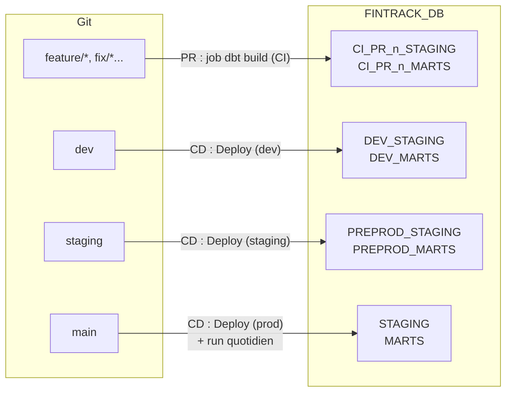

# Environnements

Un même code dbt est construit dans cinq contextes. Ils partagent la base `FINTRACK_DB`, les sources du schéma `RAW` et l'entrepôt `FINTRACK_WH`, mais chacun écrit dans **ses propres schémas**.

## Vue d'ensemble

| Contexte | Branche / déclencheur | GitHub Environment | Target dbt | Schémas Snowflake (base `FINTRACK_DB`) |
|---|---|---|---|---|
| Poste du développeur | — | — | `dev` (dans `~/.dbt/profiles.yml`), schéma `DEV_<PRENOM>` | `DEV_<PRENOM>_STAGING`, `DEV_<PRENOM>_MARTS` |
| CI de PR | pull request vers `dev`, `staging` ou `main` | aucun (secrets du dépôt) | `ci`, schéma `CI_PR_<numéro>` | `CI_PR_<n>_STAGING`, `CI_PR_<n>_MARTS` (supprimés à la fermeture de la PR) |
| Dev (intégration) | push sur `dev` | `dev` | `dev`, schéma `DEV` | `DEV_STAGING`, `DEV_MARTS` |
| Staging (recette) | push sur `staging` | `staging` | `staging`, schéma `PREPROD` | `PREPROD_STAGING`, `PREPROD_MARTS` |
| Prod | push sur `main` + run quotidien | `prod` | `prod`, schéma `STAGING` | `STAGING`, `MARTS` |

`RAW` reste unique et partagé, en lecture seule : `_stg_sources.yml` fixe la base `fintrack_db` et le schéma `raw` pour toutes les cibles.



!!! note "Deux sens du mot « staging »"

    `staging` désigne à la fois **la couche** de modèles (`models/staging/`, schéma `STAGING` en production) et **l'environnement de recette** (branche `staging`, schémas `PREPROD_*`). Le schéma de l'environnement de recette s'appelle `PREPROD` précisément pour éviter un `STAGING_STAGING` illisible.

## La macro generate_schema_name

dbt décide du schéma de chaque modèle avec la macro `generate_schema_name`, surchargée dans `macros/generate_schema_name.sql`. Elle reçoit le schéma personnalisé du modèle (`+schema: staging` ou `+schema: marts` dans `dbt_project.yml`) et la cible courante :

1. modèle sans schéma personnalisé : schéma de la cible (`target.schema`) ;
2. cible `prod` : schéma personnalisé tel quel (`STAGING`, `MARTS`) ;
3. toute autre cible : `<schéma de la cible>_<schéma personnalisé>`.

Le résultat est mis en majuscules.

| Target | `target.schema` | Modèle staging | Modèle marts | Modèle sans `+schema` |
|---|---|---|---|---|
| `dev` (poste) | `DEV_ABRAHAM` | `DEV_ABRAHAM_STAGING` | `DEV_ABRAHAM_MARTS` | `DEV_ABRAHAM` |
| `ci` | `CI_PR_12` | `CI_PR_12_STAGING` | `CI_PR_12_MARTS` | `CI_PR_12` |
| `dev` (CD) | `DEV` | `DEV_STAGING` | `DEV_MARTS` | `DEV` |
| `staging` | `PREPROD` | `PREPROD_STAGING` | `PREPROD_MARTS` | `PREPROD` |
| `prod` | `STAGING` | `STAGING` | `MARTS` | `STAGING` |

Le modèle intermédiaire est éphémère : il n'a pas de schéma, le dernier cas ne concerne aujourd'hui aucun objet.

Conséquences :

- `FINTRACK_ROLE` doit pouvoir créer des schémas dans `FINTRACK_DB` : c'est l'objet de `snowflake/04_ci_cd.sql` (`GRANT CREATE SCHEMA ON DATABASE FINTRACK_DB TO ROLE FINTRACK_ROLE`).
- Seule une cible **nommée** `prod` écrit dans les schémas de production. Ne donnez jamais ce nom à une cible locale.
- Les schémas créés par dbt appartiennent à `FINTRACK_ROLE`, qui peut donc les remplacer et les supprimer.

## Les profils dbt

dbt lit ses connexions dans un fichier `profiles.yml`, jamais versionné quand il contient un secret.

### Sur votre poste

`~/.dbt/profiles.yml`, avec une seule cible `dev` et votre schéma `DEV_<PRENOM>`. Modèle dans [Démarrage](demarrage.md#3-creer-son-profil-dbt-local).

### Dans GitHub Actions : ci/profiles.yml

`ci/profiles.yml` est versionné (exception `!ci/profiles.yml` dans `.gitignore`) car il ne contient **aucun secret** : chaque valeur sensible est lue dans une variable d'environnement avec `env_var()`. Les workflows le désignent avec `DBT_PROFILES_DIR=${{ github.workspace }}/ci`.

Il définit les cibles `ci`, `dev`, `staging` et `prod`, identiques sauf le schéma. La cible par défaut est `DBT_TARGET`, ou `ci` si la variable est absente.

| Variable | Rôle | Valeur par défaut |
|---|---|---|
| `SNOWFLAKE_ACCOUNT` | identifiant du compte | obligatoire |
| `SNOWFLAKE_USER` | utilisateur | obligatoire |
| `SNOWFLAKE_PRIVATE_KEY` | clé privée (paire de clés) | vide |
| `SNOWFLAKE_PRIVATE_KEY_PASSPHRASE` | phrase secrète d'une clé chiffrée | vide |
| `SNOWFLAKE_PASSWORD` | mot de passe (alternative à la clé) | vide |
| `SNOWFLAKE_ROLE` | rôle (`FINTRACK_CI_ROLE` pour la CI après la [séparation de la CI et de la production](secrets.md#separer-la-ci-de-la-production)) | `FINTRACK_ROLE` |
| `SNOWFLAKE_DATABASE` | base | `FINTRACK_DB` |
| `SNOWFLAKE_WAREHOUSE` | entrepôt | `FINTRACK_WH` |
| `DBT_TARGET` | cible : `ci`, `dev`, `staging` ou `prod` | `ci` |
| `DBT_CI_SCHEMA` | schéma de la cible `ci` | `CI_LOCAL` |
| `DBT_QUERY_TAG` | étiquette des requêtes dans Snowflake | `dbt-finetrack` |

Les secrets GitHub qui alimentent ces variables sont décrits dans [Secrets](secrets.md).

## Les schémas de CI : CI_PR_n

Chaque pull request a ses propres schémas, nommés d'après son numéro : la PR 12 construit dans `CI_PR_12_STAGING` et `CI_PR_12_MARTS`. Deux PR ouvertes en parallèle ne se gênent donc pas.

- **Création** : par le job `dbt build (CI)`, à chaque push sur la PR (`DBT_CI_SCHEMA=CI_PR_<n>`).
- **Étiquetage** : les requêtes portent le `query_tag` `github-ci-pr-<n>`, pour suivre leur coût dans `SNOWFLAKE.ACCOUNT_USAGE.QUERY_HISTORY` (voir [Coûts](#couts)).
- **Suppression** : à la fermeture de la PR (fusionnée ou non), le workflow `CI cleanup` appelle la macro `drop_ci_schemas`. Chaque lundi à 03:00 UTC, il supprime aussi les schémas `CI_PR_*` des PR qui ne sont plus ouvertes.

La macro ne supprime que des schémas nommés `CI_PR_<numéro>` ou commençant par `CI_PR_<numéro>_`, et compare le numéro exact : nettoyer la PR 1 ne touche pas aux schémas de la PR 12. Utilisation manuelle dans [Runbooks](runbooks.md#nettoyer-les-schemas-ci).

## Les GitHub Environments

Les jobs de déploiement déclarent un environnement GitHub (`dev`, `staging` ou `prod`). Chaque environnement :

- n'accepte que sa branche : `dev` depuis `dev`, `staging` depuis `staging`, `prod` depuis `main` ;
- peut avoir ses propres secrets, qui remplacent ceux du dépôt de même nom (par exemple un utilisateur Snowflake dédié à la production) ;
- garde l'historique de ses déploiements (onglet **Deployments** du dépôt) ;
- pour `prod` uniquement, peut exiger l'approbation d'un relecteur avant chaque déploiement.

Ils sont créés par `scripts/setup_github.sh` (voir [CI/CD](ci-cd.md#appliquer-les-protections-et-reglages-du-depot)). L'environnement `github-pages` est créé automatiquement par GitHub Pages pour le déploiement de ce site.

## Coûts

Tous les environnements partagent l'entrepôt XS `FINTRACK_WH`, qui s'éteint après 60 secondes d'inactivité. Un `dbt build` complet du projet dure environ une minute. Chaque workflow étiquette ses requêtes avec un `query_tag` :

| Origine | `query_tag` |
|---|---|
| CI de la PR n | `github-ci-pr-<n>` |
| Déploiement (CD) | `github-cd-<env>-<run_id>` |
| Run quotidien de prod | `github-scheduled-prod-<run_id>` |
| Documentation (mode connecté) | `github-docs-<run_id>` |
| Nettoyage des schémas CI | `github-ci-cleanup-<run_id>` |
| Poste d'un développeur | celui de son profil (aucun par défaut) |

Le suivi de la consommation par étiquette (`ACCOUNTADMIN`, ou un rôle qui lit `SNOWFLAKE.ACCOUNT_USAGE`) :

```sql
select query_tag, count(*) as nb_requetes, sum(total_elapsed_time) / 1000 as secondes
from snowflake.account_usage.query_history
where query_tag like 'github-%'
    and start_time > dateadd('day', -7, current_timestamp())
group by query_tag
order by secondes desc;
```

`snowflake/04_ci_cd.sql` propose aussi, en commentaire, un moniteur de ressources pour plafonner les crédits consommés.
