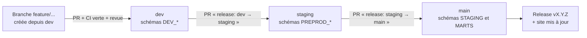

# FinTrack Analytics

FinTrack Analytics est une fintech fictive qui propose une application de gestion de finances personnelles. Ce projet transforme ses données brutes (comptes, transactions, catégories, budgets) en modèles analytiques fiables, prêts à alimenter des tableaux de bord financiers.

Ce site est la documentation de l'équipe. Il explique comment le projet est construit, comment on y travaille à plusieurs et comment la CI/CD le teste puis le déploie.

## En bref

- **Snowflake** héberge les données : base `FINTRACK_DB`, entrepôt `FINTRACK_WH` (XS), rôle `FINTRACK_ROLE`.
- **dbt** construit la chaîne de transformation, la teste et la documente : 4 sources, 10 modèles (4 vues staging, 1 modèle intermédiaire éphémère, 5 tables marts) et 53 tests.
- **Trois environnements**, chacun alimenté par une branche Git : `dev` (intégration), `staging` (recette), `main` (production).
- **Chaque pull request** est vérifiée par la CI : lint, compilation dbt, construction de cette documentation, et `dbt build` dans des schémas Snowflake jetables (limité aux modèles modifiés pour une PR vers `dev`).
- **Chaque fusion** déclenche un déploiement automatique dans l'environnement de la branche. Une fusion dans `main` publie aussi une release si la version de `dbt_project.yml` est nouvelle, et met ce site à jour.

## Liens rapides

| Je veux... | Aller à |
|---|---|
| Installer mon poste et lancer mon premier `dbt build` | [Démarrage](demarrage.md) |
| Comprendre les couches, les modèles et Snowflake | [Architecture](architecture.md), [Modèles](modeles.md) |
| Proposer une modification | [Workflow Git](workflow-git.md), [Contribuer](contribuer.md) |
| Savoir où mes modèles sont construits | [Environnements](environnements.md) |
| Comprendre un check rouge sur ma PR | [CI/CD](ci-cd.md), [Runbooks](runbooks.md#un-check-de-pr-est-rouge) |
| Configurer les secrets Snowflake de GitHub Actions | [Secrets](secrets.md) |
| Écrire un modèle ou un test dans le style du projet | [Conventions](conventions.md), [Qualité des données](qualite.md) |
| Explorer les colonnes et le lineage | [Catalogue dbt](https://abrahamkoloboe27.github.io/FinetrackProject-Snowflake/dbt/) |

## Le cycle de vie d'une modification

Chaque flèche est une pull request vérifiée par la CI. Chaque arrivée sur une branche longue est déployée par le workflow CD dans l'environnement correspondant. Le détail est dans [Workflow Git](workflow-git.md) et [CI/CD](ci-cd.md).

## Le dépôt

| Ressource | Lien |
|---|---|
| Code source | [abrahamkoloboe27/FinetrackProject-Snowflake](https://github.com/abrahamkoloboe27/FinetrackProject-Snowflake) |
| Tickets | [Issues](https://github.com/abrahamkoloboe27/FinetrackProject-Snowflake/issues) |
| Pull requests | [Pull requests](https://github.com/abrahamkoloboe27/FinetrackProject-Snowflake/pulls) |
| Exécutions CI/CD | [Actions](https://github.com/abrahamkoloboe27/FinetrackProject-Snowflake/actions) |
| Versions publiées | [Releases](https://github.com/abrahamkoloboe27/FinetrackProject-Snowflake/releases) |
| Historique des versions | [CHANGELOG.md](https://github.com/abrahamkoloboe27/FinetrackProject-Snowflake/blob/main/CHANGELOG.md) |

Projet réalisé d'après le sujet « Snowflake + dbt : FinTrack Analytics » (niveau débutant), puis outillé pour un travail en équipe.
