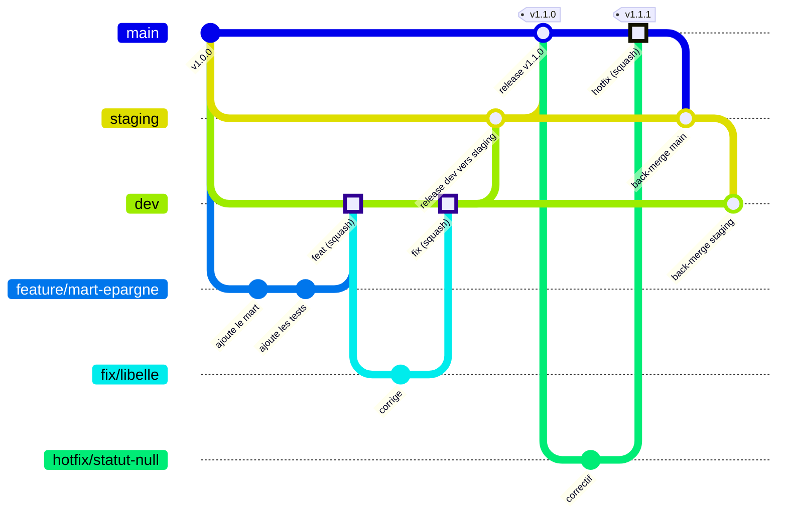

# Workflow Git

L'équipe suit un **GitFlow allégé** fondé sur des branches d'environnement : chaque branche longue correspond à un environnement Snowflake, et une modification monte de l'une à l'autre par pull request.

## Les branches longues

| Branche | Rôle | Environnement déployé | On y fusionne... |
|---|---|---|---|
| `dev` | intégration : toutes les PR de travail y arrivent | `dev` (`DEV_STAGING`, `DEV_MARTS`) | les branches de travail (squash), les back-merges (merge commit) |
| `staging` | pré-production, recette | `staging` (`PREPROD_STAGING`, `PREPROD_MARTS`) | `dev` lors d'une release, `main` lors d'un back-merge (merge commit) |
| `main` | production, branche par défaut | `prod` (`STAGING`, `MARTS`) | `staging` lors d'une release (merge commit), `hotfix/*` (squash) |

Ces trois branches sont protégées : pas de push direct, pas de suppression, pas de force push. Tout passe par une PR dont les checks sont verts. Détail dans [Protections](#protections-des-branches).

## Branches de travail

Toute branche de travail part de `dev` et y revient. Son nom dit ce qu'elle contient : `<type>/<sujet-court-en-kebab-case>`.

| Préfixe | Usage | Exemple |
|---|---|---|
| `feature/` (ou `feat/`) | nouveau modèle, nouvelle colonne, nouvelle fonctionnalité | `feature/mart-epargne-mensuelle` |
| `fix/` | correction d'un bug | `fix/solde-cumule-compte-joint` |
| `docs/` | documentation seule | `docs/runbook-rotation-cle` |
| `refactor/` | réécriture sans changement de résultat | `refactor/cte-int-transactions` |
| `test/` | ajout ou correction de tests | `test/relationships-budgets` |
| `perf/` | performance | `perf/marts-incremental` |
| `ci/` | workflows, scripts de CI | `ci/cache-pre-commit` |
| `build/` (ou `deps/`) | dépendances, outillage | `build/dbt-1-13` |
| `chore/` | entretien divers | `chore/release-1-2-0` |
| `style/` | mise en forme seule | `style/sqlfluff-marts` |
| `hotfix/` | correctif urgent de production, **créé depuis `main`** | `hotfix/statut-null-transactions` |

Dependabot crée lui-même ses branches `dependabot/...` vers `dev`.

## Le flux en image



## Règles de flux vérifiées par la CI

Le check **`PR policy`** refuse une PR dont la combinaison base / branche source n'est pas prévue :

| Base (cible de la PR) | Branches source acceptées |
|---|---|
| `main` | `staging`, `hotfix/*` |
| `staging` | `dev`, `main`, `hotfix/*` |
| `dev` | `staging`, `main`, et les branches `feature/`, `feat/`, `fix/`, `hotfix/`, `docs/`, `chore/`, `refactor/`, `test/`, `ci/`, `perf/`, `build/`, `style/`, `deps/`, `dependabot/` |

Une PR `feature/x` vers `main` est donc refusée : elle doit passer par `dev`, puis par les releases.

Une PR venant d'un **fork** vise toujours `dev`, avec une branche de travail : une branche de fork nommée `dev`, `staging` ou `main` n'est ni une promotion ni un back-merge, et `PR policy` la refuse. Les promotions et les hotfix viennent du dépôt principal.

!!! warning "Changer la branche cible d'une PR"

    La CI ne se relance pas quand la base change : ses checks resteraient ceux de l'ancienne base (une Slim CI vers `dev` au lieu du build complet vers `main`). `PR policy` échoue donc avec « CI à relancer » tant que la CI n'a pas tourné pour la nouvelle base. Après `gh pr edit <n> --base <branche>`, fermez puis rouvrez la PR (`gh pr close <n>` puis `gh pr reopen <n>`), ou poussez un commit.

## Stratégies de fusion

| PR | Méthode | Pourquoi |
|---|---|---|
| branche de travail → `dev` | **Squash and merge** | un commit par PR sur `dev`, dont le message est le titre de la PR |
| `dev` → `staging` (release) | **Create a merge commit** | conserve l'historique de `dev` : les branches restent alignées, pas de conflit à la release suivante |
| `staging` → `main` (release) | **Create a merge commit** | idem |
| `hotfix/*` → `main` | **Squash and merge** | un seul commit de correctif en production |
| back-merge `main` → `staging`, `staging` → `dev` | **Create a merge commit** | ramène le correctif sans réécrire l'historique |

!!! danger "Ne jamais squasher une release ou un back-merge"

    Un squash de `dev` vers `staging` crée sur `staging` un commit que `dev` ne connaît pas. Les deux branches divergent : conflits et différences dupliquées à chaque release suivante. Les rulesets n'autorisent que le merge commit sur `staging`.

## Titre de PR : Conventional Commits

Le titre de PR devient le message du commit lors d'un squash, puis alimente les notes de release. Le check `PR policy` exige le format [Conventional Commits](https://www.conventionalcommits.org/fr/v1.0.0/) :

```text
<type>(<portée optionnelle>)!: <description>
```

Expression vérifiée : `^(feat|fix|docs|style|refactor|perf|test|build|ci|chore|revert|release)(\([a-z0-9._/-]+\))?!?: .+`

| Type | Usage | Version |
|---|---|---|
| `feat` | nouveau modèle, nouvelle colonne | mineure |
| `fix` | correction de résultat | correctif |
| `perf` | performance | correctif |
| `refactor` | réécriture à résultat identique | aucune |
| `test` | tests | aucune |
| `docs` | documentation | aucune |
| `style` | mise en forme | aucune |
| `build` | dépendances, outillage | aucune |
| `ci` | workflows, scripts de CI | aucune |
| `chore` | entretien, back-merge, préparation de release | aucune |
| `revert` | annulation d'un commit | selon le cas |
| `release` | PR de promotion entre branches longues | — |

Le `!` signale un changement cassant pour les consommateurs (colonne renommée ou supprimée, grain modifié) : version majeure. La portée est en minuscules : `staging`, `marts`, `ci`, `docs`, `snowflake`, `deps`...

Exemples valides :

- `feat(marts): ajoute mart_epargne_mensuelle`
- `fix(staging): met le statut des transactions en minuscules`
- `refactor(marts)!: renomme ecart en ecart_budget`
- `release: dev → staging`, `release: staging → main`, `release(1.2.0): staging → main`
- `chore: back-merge main → staging`

## Procédures pas à pas

### Démarrer une tâche

1. Ouvrez ou choisissez une issue (formulaires « Bug / anomalie de données » ou « Nouveau modèle / évolution »), et assignez-la-vous.
2. Créez la branche depuis un `dev` à jour :

    ```bash
    git switch dev
    git pull --ff-only
    git switch -c feature/mart-epargne-mensuelle
    ```

3. Travaillez, testez dans vos schémas `DEV_<PRENOM>_*`, committez souvent. Les hooks pre-commit vérifient chaque commit.

    ```bash
    dbt build --select mart_epargne_mensuelle+
    git add models/marts/mart_epargne_mensuelle.sql models/marts/_marts_models.yml
    git commit -m "feat(marts): ajoute mart_epargne_mensuelle"
    ```

### Ouvrir la pull request

```bash
git push -u origin feature/mart-epargne-mensuelle
gh pr create --base dev --title "feat(marts): ajoute mart_epargne_mensuelle"
```

`gh` ouvre l'éditeur avec le modèle de PR (`.github/pull_request_template.md`) : remplissez le contexte, cochez la checklist, liez l'issue (`Closes #12`). Pour un travail pas encore prêt, ajoutez `--draft` : la CI tourne sans le `dbt build` sur Snowflake, puis `gh pr ready` déclenche le job `dbt build (CI)` (Slim CI vers `dev`, build complet vers `staging` ou `main`).

Suivez les checks :

```bash
gh pr checks --watch
```

### Garder sa branche à jour

Si `dev` a avancé pendant votre travail :

```bash
git fetch origin
git rebase origin/dev                 # tant que personne d'autre ne travaille sur votre branche
git push --force-with-lease
```

Sur une branche partagée, préférez `git merge origin/dev`, ou le bouton **Update branch** de la PR. Le squash final efface de toute façon ces commits intermédiaires.

### Relire une PR

```bash
gh pr checkout 42                     # récupère la branche en local
dbt build --select state:modified+ --state <dossier_manifest>   # facultatif : rejouer en local
gh pr review 42 --approve             # ou --request-changes -b "..."
```

Points à vérifier en revue : le résultat métier (le résumé `dbt build` du job CI), les tests et descriptions YAML, le nommage, l'impact sur les modèles en aval (lineage), la documentation. Résolvez chaque conversation avant la fusion : c'est une condition des rulesets.

### Fusionner dans dev

Quand les checks sont verts et la PR approuvée :

```bash
gh pr merge 42 --squash --delete-branch   # mainteneur seul : ajoutez --admin
```

Vous pouvez aussi l'armer à l'avance : `gh pr merge 42 --squash --auto` fusionne dès que les conditions sont remplies. Le workflow CD déploie alors `dev` dans `DEV_STAGING` et `DEV_MARTS`.

### Publier une release : dev → staging

Quand `dev` contient un lot cohérent et que son déploiement est vert :

```bash
gh pr create --base staging --head dev \
  --title "release: dev → staging" \
  --body "Promotion de dev vers staging : PR fusionnées depuis la dernière release."
gh pr merge <numero> --merge          # merge commit, et SURTOUT pas --delete-branch ; mainteneur seul : ajoutez --admin
```

Le workflow CD déploie `staging` dans `PREPROD_STAGING` et `PREPROD_MARTS`. Faites la **recette** sur ces schémas : contrôles métier, tableaux de bord de test, comparaison avec la production.

### Publier une release : staging → main

La version publiée est celle de `dbt_project.yml`. Avant la release, faites passer une PR sur `dev` qui monte la version et complète `CHANGELOG.md` :

```bash
git switch dev && git pull --ff-only
git switch -c chore/release-1-2-0
# dbt_project.yml : version: '1.2.0'
# CHANGELOG.md : déplacer « Non publié » sous « [1.2.0] - AAAA-MM-JJ »
git commit -am "chore(release): prépare la version 1.2.0"
git push -u origin chore/release-1-2-0
gh pr create --base dev --title "chore(release): prépare la version 1.2.0"
```

Puis, une fois cette PR promue jusqu'à `staging` et la recette validée :

```bash
gh pr create --base main --head staging \
  --title "release(1.2.0): staging → main" \
  --body "Mise en production de la version 1.2.0. Recette validée sur PREPROD."
gh pr merge <numero> --merge          # mainteneur seul : ajoutez --admin
```

Le workflow CD déploie la production (après approbation si l'environnement `prod` exige un relecteur), crée le tag `v1.2.0` et la release GitHub avec des notes générées, puis le workflow Docs met ce site à jour. Si la version n'a pas changé, aucune release n'est créée.

Choix du numéro (versionnage sémantique) : **majeure** pour un changement cassant pour la BI, **mineure** pour un nouveau modèle ou une nouvelle colonne, **correctif** pour une correction.

### Corriger en urgence : hotfix

Un bug en production qui ne peut pas attendre la prochaine release :

```bash
git switch main && git pull --ff-only
git switch -c hotfix/statut-null-transactions
# corriger, puis dbt build dans vos schémas DEV_<PRENOM>_*
# monter la version de correctif : dbt_project.yml (1.1.0 → 1.1.1) et CHANGELOG.md
git commit -am "fix(staging): traite les statuts NULL"
git push -u origin hotfix/statut-null-transactions
gh pr create --base main --title "fix(staging): traite les statuts NULL"
gh pr merge <numero> --squash --delete-branch   # mainteneur seul : ajoutez --admin
```

La production est redéployée et, si la version a été montée, la release `v1.1.1` est créée. Le correctif n'existe alors que sur `main` : le job `sync-check` du workflow CD affiche l'avertissement « back-merge main → staging → dev nécessaire ».

### Back-merge après un hotfix

Ramenez le correctif sur `staging`, puis sur `dev`, avec des merge commits :

```bash
gh pr create --base staging --head main --title "chore: back-merge main → staging" \
  --body "Ramène le hotfix #<numero> sur staging."
gh pr merge <numero> --merge          # mainteneur seul : ajoutez --admin

gh pr create --base dev --head staging --title "chore: back-merge staging → dev" \
  --body "Ramène le hotfix #<numero> sur dev."
gh pr merge <numero> --merge          # mainteneur seul : ajoutez --admin
```

Ne supprimez jamais `main` ni `staging` à la fusion. En cas de conflit, voir [Runbooks](runbooks.md#conflit-lors-dune-release-ou-dun-back-merge).

## Protections des branches

Les règles sont décrites dans `.github/rulesets/` et appliquées par `scripts/setup_github.sh` (voir [CI/CD](ci-cd.md#appliquer-les-protections-et-reglages-du-depot)).

| Règle | `main` | `staging` | `dev` |
|---|---|---|---|
| PR obligatoire | oui | oui | oui |
| Approbations requises | 1 | 1 | 1 |
| Revue du code owner (`.github/CODEOWNERS`) | oui | non | non |
| Approbation annulée par un nouveau push | oui | oui | oui |
| Conversations résolues avant fusion | oui | oui | oui |
| Checks requis | `Lint`, `dbt parse`, `Docs build`, `dbt build (CI)`, `PR policy` | idem | idem |
| Méthodes de fusion | merge commit (release), squash (hotfix) | merge commit | squash ; merge commit pour le back-merge |
| Suppression, force push | interdits | interdits | interdits |
| Contournement | administrateurs du dépôt | idem | idem |

!!! info "Mainteneur seul"

    GitHub interdit d'approuver sa propre PR. Tant que l'équipe ne compte qu'une personne, l'administrateur fusionne grâce au contournement des rulesets : case « Merge without waiting for requirements to be met (bypass rules) » de la PR, ou `--admin` en ligne de commande, avec la méthode de fusion du type de PR :

    - branche de travail → `dev`, et `hotfix/*` → `main` : `gh pr merge <numero> --squash --admin` ;
    - release (`dev` → `staging`, `staging` → `main`) et back-merge : `gh pr merge <numero> --merge --admin`, **jamais** `--squash`. Le contournement lèverait aussi la règle qui l'interdit.

    Le contournement lève aussi les checks : par convention, ne l'utilisez qu'à la place de la revue, une fois tous les checks verts. Dès qu'un deuxième membre rejoint le dépôt, chaque PR est relue par quelqu'un d'autre que son auteur.

## Bonnes pratiques

- **Petites PR** : une PR = un sujet, relisible en moins de 15 minutes.
- **Une PR en brouillon** (`--draft`) dès le début pour montrer son travail et obtenir des retours tôt.
- **Ne jamais committer sur `dev`, `staging` ou `main`** en local : `git switch -c` d'abord.
- **Supprimer sa branche** après la fusion (`--delete-branch`, ou le bouton de la PR) : GitHub ne le fait pas automatiquement, pour ne jamais supprimer une branche longue.
- **Relancer plutôt que contourner** : un check rouge se corrige, il ne s'ignore pas.
